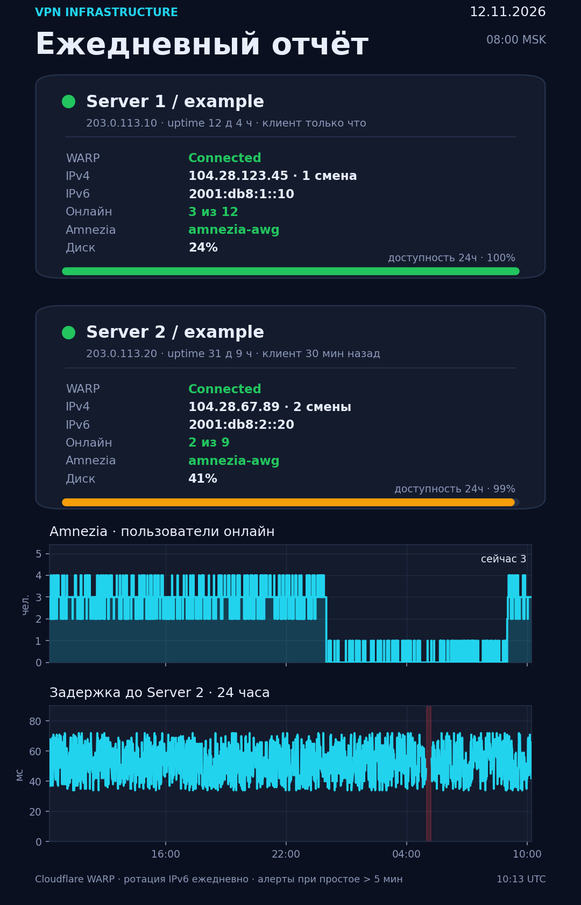

# Amnezia + Cloudflare WARP

Готовый набор для VPS: трафик клиентов **AmneziaWG** идёт через **Cloudflare WARP**, а SSH, Caddy и сам VPN-транспорт остаются на прямом канале. Сверху — мониторинг, ежедневный отчёт с графиками, алерты и Telegram-бот (всё, кроме мониторинга, опционально).

[](LICENSE)




## Зачем это нужно

AmneziaWG даёт клиентам быстрый и незаметный VPN, но трафик выходит с IP-адреса вашего VPS. Cloudflare WARP добавляет второй слой: для сайтов клиенты выглядят как обычные посетители Cloudflare, а не как VPN-сервер. При этом:

- **SSH и панели управления не отваливаются** — служебный трафик помечается и уходит мимо WARP.
- **Caddy на 80/443 продолжает работать** — ответы на опубликованные порты Docker не заходят в туннель.
- **Клиенты Amnezia не теряют соединение** — UDP-транспорт и рукопожатия идут по физическому интерфейсу.
- **IPv6-адрес WARP меняется ежедневно** — ключи ротируются по расписанию.
- **Всё видно** — онлайн-пользователи, задержка до второго сервера, смены IPv4, последнее рукопожатие клиента.

## Возможности

| | |
|---|---|
| 🔀 Маршрутизация | Трафик Amnezia/Docker → WARP, служебный трафик → напрямую |
| 🛡 Anti-leak | Пока WARP переподключается, клиентский трафик не утекает через физический интерфейс |
| 🔄 Ротация | Ежедневное переподключение WARP с новыми ключами (новый IPv6) |
| 📊 Мониторинг | Проверка каждую минуту: WARP, контейнер, диск, пинг пира |
| 👥 Онлайн | Число одновременно подключённых клиентов Amnezia и их доля от всех |
| 🕒 Активность | Время последнего рукопожатия и IP последнего клиента |
| 🌐 IPv4-журнал | История смен внешнего IPv4 WARP с количеством за 24 часа |
| 📈 Отчёт | PNG-дашборд раз в сутки, отправка в Telegram (опция) |
| 🚨 Алерты | WARP/контейнер/диск/пир/маршруты, с уведомлением о восстановлении |
| 🤖 Бот | Статус, детали по серверам, WARP, ping, отчёт по кнопке (опция) |
| 🩺 Самовосстановление | Проверка bypass-маршрута и возврат правил после переподключения WARP |

## Требования

- Ubuntu 22.04 / 24.04, root-доступ.
- Установленный **AmneziaWG** (контейнер `amnezia-awg*`, интерфейс `amn0`) — ставится приложением Amnezia или скриптом.
- Установленный **Cloudflare WARP** (`warp-cli`, интерфейс `CloudflareWARP`).
- `python3` + `python3-matplotlib` (для отчёта), `curl`, `iptables`, `openssh-client`.
- Опционально: второй сервер для парного мониторинга и Telegram-бот.

### Где взять VPS

Серверы этого проекта работают на [HostVDS](https://hostvds.com/?affiliate_uuid=59ca71b7-ebf7-485c-81ac-ec6da6a5d168) и [Aeza](https://aeza.net/?ref=827670) — проверенные площадки с минимальными ценами и оплатой в рублях. У HostVDS смена IP бесплатная.

<sub>Ссылки партнёрские: для вас цена не меняется, а проекту это помогает развиваться.</sub>

## Быстрая установка

```bash
git clone https://github.com/ru235/amnezia-cloudflare-warp.git
cd amnezia-cloudflare-warp
sudo ./install.sh
```

Установщик сам определит внешний IP, интерфейс, контейнер Amnezia и UDP-порт, настроит маршрутизацию и включит таймеры. Проверка:

```bash
systemctl list-timers 'peer-monitor*' 'warp-*'
ip route get 1.1.1.1 mark 0x100cf     # должен быть dev eth0/enp0s3, НЕ CloudflareWARP
curl -4 -s https://www.cloudflare.com/cdn-cgi/trace | grep '^ip='
```

### Два сервера (как в примере на скриншоте)

```bash
# сервер 1
sudo ./install.sh --self-name Helsinki --peer-name Aeza --peer-ip 203.0.113.20

# сервер 2
sudo ./install.sh --self-name Aeza --peer-name Helsinki --peer-ip 203.0.113.10
```

Установщик напечатает публичный ключ для мониторинга пира — добавьте его на второй сервер:

```bash
ssh root@203.0.113.20 "mkdir -p ~/.ssh && cat >> ~/.ssh/authorized_keys" < /root/.ssh/id_ed25519_monitor.pub
```

## Telegram — опция

Без Telegram проект полностью работает: мониторинг пишет данные, отчёт строится в PNG, маршрутизация и ротация живут своей жизнью. Telegram включает отчёты, алерты и бота:

```bash
sudo ./install.sh --telegram
# или без интерактива:
sudo ./install.sh --telegram --token '123456:ABC...' --chat 123456789
```

На двух серверах бот запускается на одном (`--bot-role active`), а второй держит «страховку» (`--bot-role passive`): если активный сервер пропал, бот поднимается на резервном.

Подробно: [docs/TELEGRAM.md](docs/TELEGRAM.md).

## Что установится

```
/usr/local/sbin/warp-amnezia-routing.sh   правила маршрутизации
/usr/local/sbin/peer-monitor.sh           минутный монитор и алерты
/usr/local/sbin/warp-rotate.sh            ежедневная ротация ключей
/usr/local/sbin/warp-daily-report.py      PNG-отчёт и отправка в Telegram
/usr/local/sbin/warp-bot.py               Telegram-бот (опция)
/usr/local/sbin/bot-guard.sh              резервный бот (опция)

/etc/warp-monitor.conf                    основная конфигурация
/etc/warp-telegram.env                    токен и chat id (опция)

/var/lib/warp-monitor/history.csv         история проверок
/var/lib/warp-monitor/ipv4.log            журнал IPv4 WARP
/var/lib/warp-monitor/state.env           состояние алертов
/var/lib/warp-monitor/report-*.png        отчёты
```

Таймеры: `peer-monitor.timer` (раз в минуту), `warp-daily-report.timer`, `warp-rotate.timer`, `bot-guard.timer` (опция).

## Конфигурация

Основные параметры — в `/etc/warp-monitor.conf` (полный пример: [config/warp-monitor.conf.example](config/warp-monitor.conf.example)):

| Ключ | Значение |
|---|---|
| `SELF_NAME`, `SELF_IP` | Имя и внешний IPv4 этого сервера |
| `PEER_NAME`, `PEER_IP` | Второй сервер (необязательно) |
| `REPORT_UTC`, `ROTATE_UTC` | Время отчёта и ротации в UTC |
| `REPORT_TIME` | Подпись времени в шапке отчёта, например `08:00 MSK` |
| `BYPASS_MARK` | Метка «мимо WARP», по умолчанию `0x100cf` |
| `BYPASS_PRIO` | Приоритет `ip rule`, по умолчанию `10` |
| `WARP_IF`, `AWG_IFACE`, `AWG_PORT` | Интерфейсы и порт (обычно определяются сами) |
| `BOT_ROLE` | `active`, `passive` или `none` |

После правки конфига достаточно подождать минуту — скрипты перечитывают его на каждом запуске.

## Полезные команды

```bash
# статус таймеров
systemctl list-timers 'peer-monitor*' 'warp-*' 'bot-guard*'

# последние строки мониторинга
tail -5 /var/lib/warp-monitor/history.csv

# журнал смен IPv4
cat /var/lib/warp-monitor/ipv4.log

# прогнать проверку вручную
sudo /usr/local/sbin/peer-monitor.sh

# построить отчёт вручную (PNG в /var/lib/warp-monitor)
sudo /usr/local/sbin/warp-daily-report.py

# проверить бота без отправки
sudo /usr/local/sbin/warp-bot.py --test

# перезапустить ротацию
sudo systemctl start warp-rotate.service
```

## Документация

- [docs/INSTALL.md](docs/INSTALL.md) — длинная инструкция: от чистого VPS до работающей связки.
- [docs/ARCHITECTURE.md](docs/ARCHITECTURE.md) — как устроен путь пакета, метки, nftables и мониторинг.
- [docs/TELEGRAM.md](docs/TELEGRAM.md) — бот, отчёты, алерты, резервный режим.
- [docs/TROUBLESHOOTING.md](docs/TROUBLESHOOTING.md) — диагностика типовых проблем.

## Удаление

```bash
sudo ./uninstall.sh               # убрать сервисы, данные сохранить
sudo ./uninstall.sh --purge       # убрать всё, включая данные и правила маршрутизации
```

## Важно

Проект меняет сетевые правила сервера и запускает трафик через сторонний сервис Cloudflare WARP. Перед установкой убедитесь, что у вас есть доступ к консоли провайдера (KVM/VNC): ошибка в правилах может закрыть SSH. Все действия — на ваш риск. Лицензия [MIT](LICENSE).
